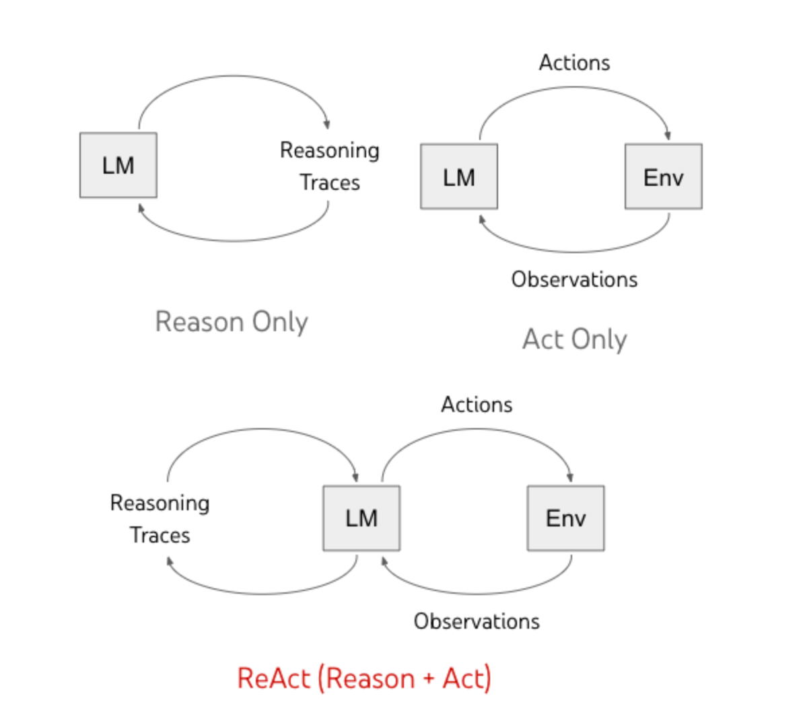
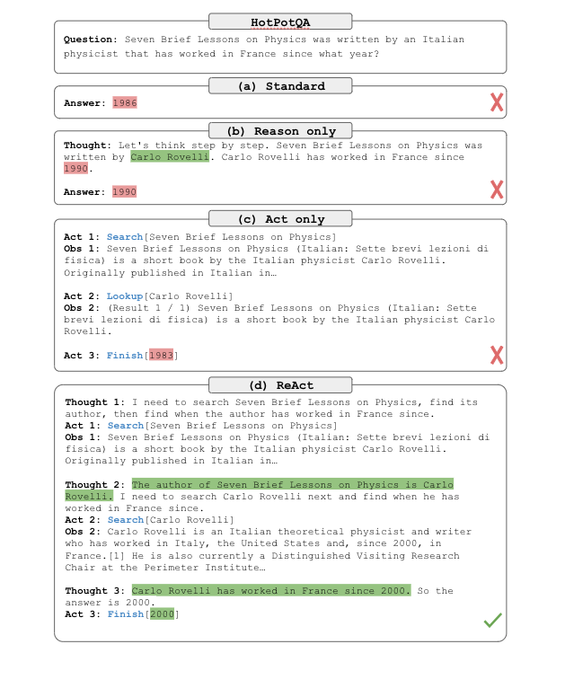

# ReAct - Synergizing Reasoning and Acting in Language Models

**Date**: 10-23-2026 • [Homebase](../README.md) • #nlp #llm #agents #reasoning #prompting

**Link:** https://research.google/blog/react-synergizing-reasoning-and-acting-in-language-models/

### TL;DR:   
- CoT prompting: model is not grounded in the external world, uses its own learned representations to generate reasoning - cannot explore/reason or update its knowledge  
- Pre-trained LLMs that map text context to text actions do not reason abstractly or maintain a working memory for long-horizon tasks  
- ReAct proposes a combination of reasoning and acting (Reason + Act = ReAct) which can solve language reasoning and decision making tasks  
	- Action: interact with the external world and produce results that the model can observe  
	- Reasoning: doesn't change the external world, but helps the model organize information and update the model with information to help future reasoning and acting

### Problem:  
- 

### Key equations/terms: 

### Design choices + why:   
  
- The reasoning-acting loop that ReAct utilizes

  
- Example of ReAct in comparison with reason-only and act-only

### Results: 

### Open questions: 

**Builds on:**   
**Rating:** ⭐️⭐️⭐️

---  
#### Notes for myself:
