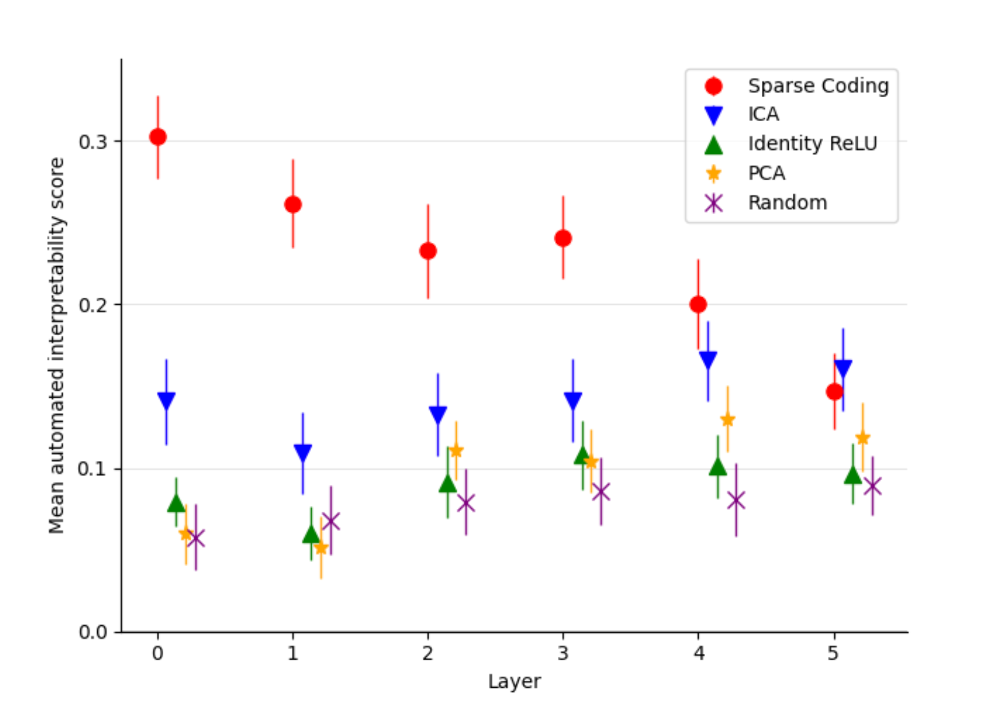

# Sparse Autoencoders Find Highly Interpretable Features in Language Models

**Date**: 10-25-2026 • [Homebase](../README.md) • #interpretability #mech-interp #sparse-autoencoders #nlp #llm

**Link:** https://arxiv.org/abs/2309.08600

### TL;DR:   
- When there are more features than neurons in a neural network, the network must use superposition to represent all of the features, thus leading to polysemanticity  
	- This makes neural networks difficult to interpret in a human-parsable manner  
- The paper introduces a method (sparse autoencoders) to resolve superposition using a scalable and unsupervised method

### Problem: 

### Key equations/terms: 

<b>Polysemanticity:</b> the phenomenon where neurons activate in multiple, semantically distinct contexts, which prevents us from identifying explanations for what neural networks (specifically the neurons) are actually doing

<b>Superposition:</b> when there are more features than neurons in a neural network, so one neuron may represent multiple features

<b>Autoencoder:</b> An unsupervised neural network that learns to compress input data into a lower dimensional representation, then reconstruct the original input as closely as possible  
- <b>Undercomplete Autoencoder:</b> specific autoencoder where the hidden layer has fewer neurons/dimensions than the input layer

**What makes superposition possible?**  
- A key example: say that we want to represent A, B, and C using vectors in $\mathbb{R}^2$. We could say  
$$A = \begin{bmatrix} 1  \\  0  \end{bmatrix}, B = \begin{bmatrix} 0  \\  1  \end{bmatrix}, C = \begin{bmatrix} 1  \\  1  \end{bmatrix}$$  
- Then activating both A and B neurons would be the same as just activating neuron C, which would lead to interference if neurons A and B have no correlation with neuron C  
- Therefore it is possible to represent more features with less neurons using sparse encoding

<b>Causal Intervention:</b> enhance or suppress the feature activation and see if the original model's behavior changes in the predicted way

**How does the paper find out the concept(s) that each feature maps to?**  
1. Use automated interpretability to generate a human-readable explanation  
2. Remove/modify the feature's activation, then observe how the model's output changes (relates to causal intervention)

<b>Kullback-Leibler (KL) Divergence:</b> measures how much information is lost when using an approximating probability distribution instead of a true probability distribution  
Loading latex...  
### Design choices + why: 

### Results:   
- SAE interpretability decreases with the number of layers in the original neural network  

### Open questions:   
- Look into the autointerpretability procedure introduced in Bills et al. (2023) (https://arxiv.org/html/2309.08600v3#bib.bib2)

**Builds on:** [Attention Is All You Need](attention-is-all-you-need.md)  
**Rating:** ⭐️⭐️⭐️⭐️⭐️

---  
#### Notes for myself:
